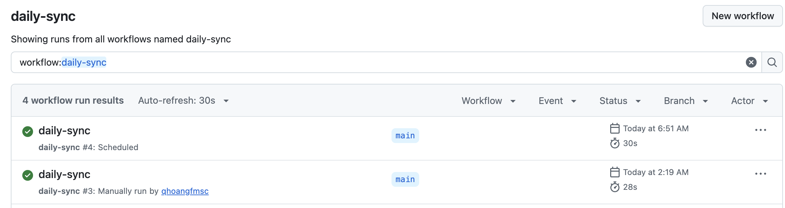
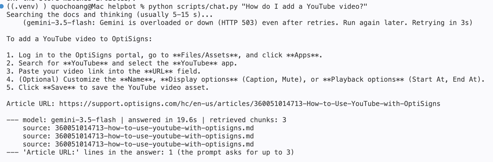

# helpbot
Support-bot knowledge pipeline: scrape Help Center articles, convert them to clean Markdown, load them into a Gemini File Search
store through the API, keep the store in sync with a daily job (only changes are uploaded), and chat with the result.

## Run locally: step by step
You need Python 3.11+, Git, and a free Gemini API key from https://aistudio.google.com/apikey (the key is the only secret).

**1. INSTALLATION**
```bash
git clone <this repo> && cd helpbot
python3 -m venv .venv && . .venv/bin/activate
pip install -r requirements-dev.txt
```
**2. Add key.** Copy the template, then open `.env` (not `.env.sample`) and type your key after `GEMINI_API_KEY=`.
```bash
cp .env.sample .env
```
**3. Load the articles into the store** (first run ~2-3 min; it prints `added=...`; run it again and everything is `skipped`)
```bash
python scripts/sync_docs.py
```
**4. Check what is in the store** (read-only; ends with `OK: ...` when every article is uploaded)
```bash
python scripts/check_store.py
```
**5. Ask the bot** (answer with `Article URL:` lines in 5-25 s; no question = interactive chat)
```bash
python scripts/chat.py "How do I add a YouTube video?"
```
**6. Run the job in Docker** (the same job the daily schedule runs: it runs once and exits 0)
```bash
docker build -t helpbot . && docker run --rm --env-file .env helpbot
```
Offline tests: `pytest -q`.

Settings (store name, timeouts, chat model, how many articles) are in `config/settings.toml`. Exit codes: 0 ok, 1 some uploads failed,
2 config/key problem, 3 API/network problem (each prints a specific message). The free tier allows ~20 chat requests per model per day.

## How it works
1. **Scrape** (`helpbot/zendesk.py`): public Help Center API. Which articles: the ids in `config/article_ids.txt` (always kept, e.g. the
   YouTube one) **plus the 40 most recently updated** (`newest_articles`), so new articles are picked up. Overlaps count once.
2. **Markdown** (`helpbot/markdown.py`): headings, lists, code blocks, tables, images and links are kept, editor noise removed.
   Files in `articles/` are `<id>-<slug>.md`, starting with `# Title` and `Article URL: <url>`.
3. **Delta** (`helpbot/sync.py`): the SHA-256 of each file is stored as document metadata in the store; each run compares it with the
   fresh scrape: *added*, *updated* (new version uploaded, then the old deleted) or *skipped*. No database or state file.
   A document is deleted only when its article disappears from the site; older articles that left the newest 40 stay.
4. **Chunking** (`helpbot/chunking.py`): 400 tokens per chunk, 50 overlap (~12%). Articles average ~1.4k tokens, so a few steps of a
   procedure stay together and a cut sentence is still retrievable. The API chunks server-side and reports no counts, so
   `chunks_estimated` in the log is a local estimate.

## Evidence
- **Daily job logs**: `.github/workflows/daily-sync.yml` builds the Docker image and runs the job once a day (21:00 UTC = 04:00 Vietnam time, outside business hours; the key is a repository secret).
  Both triggers work: **#4 ran by the schedule** (Success, 30 s; GitHub started it late, 06:51 Vietnam time, as it may under load) and
  **#3 by hand** ("Run workflow"). 
  Details of the manual run: [run #3, Success, 28 s, commit a80c530](https://github.com/qhoangfmsc/helpbot/actions/runs/41233639313) (GitHub asks for a
  sign-in to open the raw log; the status and the `run-log` artifact are listed on the public run page). Its last log line (from before the newest-articles change, so 40 articles):
  `2026-10-31 19:19:30,826 INFO done added=0 updated=0 skipped=40 deleted=0 failed=0 files=0 chunks_estimated=0 store_documents=40`
- **Files and chunks embedded** (first load of the 74 articles, by the user): `INFO done added=34 updated=0 skipped=40 deleted=0 failed=0 files=34 chunks_estimated=164 store_documents=74` ([terminal screenshot](docs/img/first-sync.png))
- **Assistant answer (screenshot)** to "How do I add a YouTube video?" (`python scripts/chat.py`): 5 steps, one `Article URL:` line, 3 retrieved chunks from the right
  article. The first attempt got an HTTP 503 from Gemini and the script retried by itself. The prompt is `prompts/system_prompt.txt` (verbatim).

  
- **Tests**: `tests/scrape_quality`, `tests/vector_upload`, `tests/daily_job`, `tests/repo_hygiene` (green check from `tests.yml`).
- **Scrape fidelity**: `python scripts/verify_articles.py` re-fetches the committed articles and compares them with the live site.

## Limits and what was cut
AI Studio's chat has no File Search tool, so the assistant is configured by API (`scripts/chat.py`). No chat UI, no Postgres/Redis
(state lives in the store). Reasons and pros/cons of every skipped item: `docs/backlog.md`; code conventions: `docs/conventions.md`.
